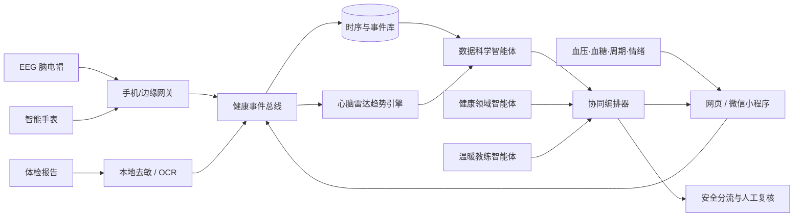

# 系统架构

## 黑客松版本

网页和小程序使用完全合成数据，在端侧模拟设备流；文件只在本地解析元数据；聊天使用可审计的规则回复。这样可以安全展示完整体验，不需要上传参赛者的健康数据。

## 生产版本建议

- API：FastAPI / TypeScript Worker 均可；PHA 官方框架当前为 FastAPI + React；
- 数据：PostgreSQL/TimescaleDB 存储结构化与时序特征，S3 兼容对象存储保存加密报告与短期原始 EEG；
- 模型：保持数据科学、健康领域和教练三个角色分离，由编排器按问题动态调用；
- 隐私：默认端侧特征提取，原始 EEG 短期留存，细粒度授权，所有智能体调用可追溯；
- 安全：医疗免责声明只是最低要求，还需要内容分类、危机识别、输出证据与人工升级。
